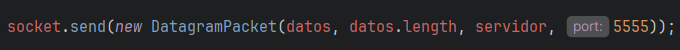
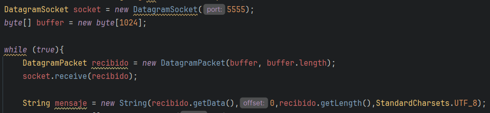

# Ejercicio palabra mas larga (UDP)

Para enviar las palabras del cliente al servidor primero pedimos al usuario que introduzca los valores en 3 variables diferentes.
Juntamos las palabras en un String y lo separamos con comas.
Creamos un socket y un servidor para poder enviar y recibir datos, mandamos el mensaje con un socket send al que añadimos el servidor y el texto que queremos enviar.  
  

Para recibir el mensaje desde el servidor creamos un socket y un packet al que le ponemos la variable de recibido:  
  

Separamos el mesaje con un split y le aplicamos las comas. Ahora que tenemos las variables aplicadas dentro del servidor le aplicamos las condiciones para ver cual es mas larga.
Tras aplicar la condición enviamos con el socket de nuevo al cliente el cual imprimirá la palabra mas larga.